<p align="center">
  
</p>

```sql
SELECT
    name        = 'Angel Alfredo Solano Juarez',
    role        = 'Computer Engineer · Web, ERP & Data Developer',
    status      = 'Intern in training · Student' 'Billingual(Advanced English and Native Spanish),
    works_with  = ARRAY['Next.js', 'Web development', 'Dynamics 365 Business Central (AL)', 'SQL Server', 'MySQL', 'Claude Code'],
    learning    = ARRAY['Advanced TypeScript', 'API architecture', 'DevOps'],
    philosophy  =  'Work hard. Never stop learning.', 'If i can imagine it, it will happen.'
FROM   angel_solano;
```

<p align="center">
  
  <br />
  
</p>

<p align="center"><sub>Off the clock: Real Madrid · NBA · video games · Star Wars</sub></p>
